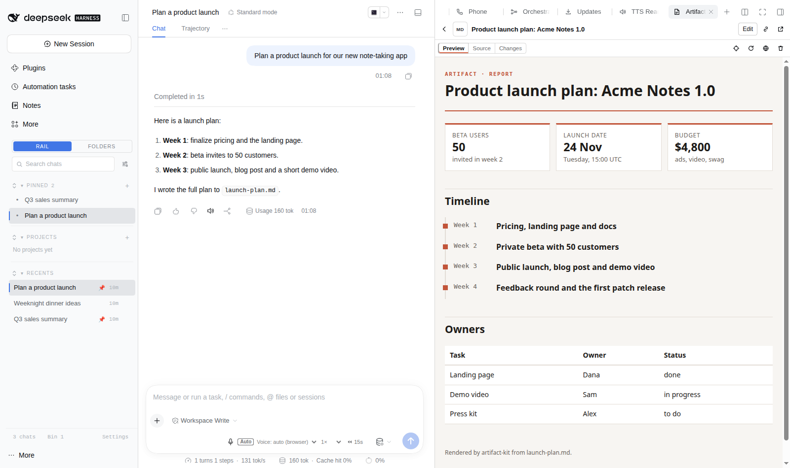

# dsh-artifacts 2

[](https://www.npmjs.com/package/@lucagiftzek/dsh-artifacts)

An Artifacts tab that previews every file your agents make, with live reload, version history and templates.

Install from npm: `dsh plugin --profile web add @lucagiftzek/dsh-artifacts`, or from GitHub: `dsh plugin --profile web add github:lucagiftzek/dsh-artifacts`.

```bash
dsh plugin --profile web add dsh-better-sidebar   # the tab host, skip if installed
dsh plugin --profile web add @lucagiftzek/dsh-artifacts
# or from GitHub: dsh plugin --profile web add github:lucagiftzek/dsh-artifacts
# restart dsh web; the /report/ server module goes into your reverse proxy (see Install / operate)
```



<sub>Screenshot from a demo DSH instance with sample data.</sub>

Artifacts for the DeepSeek Harness web GUI: a sidebar tab, a server, a bridge and
a CLI that together turn ~/reports/ into a Claude/ChatGPT/Gemini-class artifact
system, with lower long-term token use, real web apps, two-way interaction with
the chat, version history, and image / speech / video generation.

    agent ──write/edit .md, .html, app/──▶ ~/reports/ ──▶ artifact server (in your DSH reverse proxy)
      ▲                                            │  md→html, apps, media, _lib, bridge, API
      │   artifact inbox / state                   ▼
      └──── chat ◀── dsh.send / forms / pick-and-ask ── Artifacts sidebar tab (iframe)

## What is in the box

| Part | Path | Role |
|---|---|---|
| Sidebar tab | src/client.jsx → lib/client.js | list (This chat / All, search, kinds, Hidden) with thumbnails and a download icon per row, detail with Preview / Source / Changes, the media and file viewer page, downloads, version arrows + restore, pick-and-ask, "Fix with agent", public toggle, de-list, trash, inbox banner; chat links to ~/reports/* open here rendered |
| Server module | server/artifacts_server.py, files.py, viewer.py | imported by your DSH reverse proxy; owns /report/ and /report-public/: rendering, the enclosure page for media and files, downloads, Range, thumbnails, listing state |
| Indexer | server/indexer.py | niced child process: incremental transcript attribution + version snapshots |
| Bridge | server/bridge.js | injected into every served HTML page: window.dsh, Claude/OpenAI aliases, live reload |
| Media + AI | server/media.py | Mistral (Vibe subscription) chat + FLUX images, Voxtral TTS/STT, DashScope, local ComfyUI, Gemini video (opt-in) |
| Kit | contrib/artifact-kit | Markdown → themed HTML (kpi, charts, callouts, timeline, progress, columns, details, mermaid, math, actions, forms, media, figures, pull quotes, lead, footnotes; templates report, dashboard, plan, comparison, brief, article) |
| CLI | contrib/artifact | the agent interface: new, list, add, remove, relist, retitle, show, versions, diff, restore, inbox, state, state-set, public, media, libs, motion, export |
| Motion | contrib/motion.py + motion/ (npm: hyperframes) | animated explainers as code: `artifact new X --type motion` scaffolds X.html (player: scrubber, scene chips, timed change requests, export buttons, latest render) + X.motion/index.html (HyperFrames composition, one paused GSAP timeline); `artifact motion check/snapshot/voice/export`; renders locally or on a remote host over ssh+rsync (DSH_MOTION_REMOTE_HOSTS) |
| Templates | src/engine/*.ts → lib/engine/ + templates/ (scripts/sync-templates.sh) | reusable layouts, see [Templates](#templates): agent tools `artifact_templates`, `artifact_template_info`, `artifact_from_template`, `artifact_template_save` and the same in the CLI (JSON Schema validation, assets copied, lossless JSON output) |
| Agent tools + skill | lib/index.js → lib/tools.js, lib/listing.js (src/*.ts) | registered by the node half at start with guarded dynamic imports: the four template tools and `artifact_list`, `artifact_add`, `artifact_remove`, `artifact_update`; the packaged skill publish-artifact is registered with the host skill registry |
| Library shelf | vendor/ (scripts/vendor.sh) | React, ReactDOM, Babel, Recharts, Tailwind, preact-htm, Chart.js, d3, three, mermaid, KaTeX, lucide, marked, PapaParse, Leaflet, GSAP (+ plugins under gsap/), HyperFrames player/runtime at /report/_lib/ |
| Skill | skills/publish-artifact/SKILL.md | how agents should use all of the above (registered automatically; a copy in ~/.dsh/skills wins) |

## Why v2 (what was broken in v1)

1. **"This chat" was usually empty.** Attribution rescanned a chat's transcripts on
   every index request, keyed on the global file list (any new file anywhere forced
   a 10-100 s rescan; the client waited 2 s), and it ignored tool/ptc-dispatch-start
   rows whose arguments are objects, that is every write made from inside run_code.
   v2 tails each zstd transcript frame by frame from a stored cursor (full backfill
   of 892 MB: 75 s once; steady state: milliseconds) and also records explicit
   claims from the CLI ($DSH_SESSION_ID). Index requests are ~30 ms with ETag/304.
2. **The .md opened instead of the page.** .md requested by a browser now renders
   (?raw=1 or curl gets the source), md+html pairs are one artifact, /report/x.html
   is rendered on the fly from x.md, and chat links to ~/reports/* open the
   rendered artifact in the tab.
3. **Kit pages did not adapt to text length.** Long words, KPI values, table cells,
   headings and TOC entries now wrap; widths adapt to the content (wide tables get a
   wide page); chart label space is measured, long x labels rotate, labels with
   commas parse, ticks are round numbers.

## Token economics

- Templates before everything: a known kind of deliverable is a JSON data file (a few
  KB) filled into a finished layout, instead of a page written from scratch.
- Markdown first (35-40 % fewer output tokens than hand-written HTML on a typical
  report, far more with charts), rendered server-side: no render step, no HTML in
  context.
- Edit, never rewrite: every save is snapshotted and live-reloads the preview.
- state-set pushes data into a running app without touching its code.
- Pick-and-ask sends a compact reference (selector + heading + text) instead of
  the user pasting or the agent re-reading the page.
- Libraries are served locally, never inlined; the CLI + skill cost zero tokens
  per turn until used (no tool schemas in every request).

## Templates

A template is a finished, tested layout for one kind of deliverable. An agent writes only the data (JSON); it
is validated against the template's JSON Schema, local images and videos are copied next to the artifact, and the
page is written into the artifacts folder (`ARTIFACT_DIR`, default `~/reports`). Bundled: `report-text`, `article`,
`dashboard`, `review-queue`, `video-explainer`, `video-page` (see [templates/README.md](templates/README.md)).

### For users

- Nothing to set up: after installing the plugin and restarting `dsh web`, every agent on the install sees the
  four tools below and the `publish-artifact` skill, whose first step is "templates first".
- Your own templates: agents save them with `artifact_template_save` into the user library
  `${DSH_HOME:-~/.dsh}/artifacts/templates`. You can also drop template folders there by hand, or point
  `ARTIFACT_TEMPLATES` (colon separated) at your own libraries.
- Search order, first match per id wins: `$ARTIFACT_TEMPLATES`, `~/estate/templates/artifacts` (if it exists),
  the user library, the bundled copy. A user template with a bundled id overrides the bundled one.
- Settings (environment of `dsh web` and of the CLI): `ARTIFACT_DIR` (artifacts folder), `ARTIFACT_BASE_URL`
  (URL prefix, default `/report`), `ARTIFACT_TEMPLATES` (extra libraries), `ARTIFACT_TEMPLATES_WRITE` (where agents
  save templates; default: the first writable `ARTIFACT_TEMPLATES` entry, else the user library),
  `DSH_ARTIFACTS_TOOLS=0` (do not register the tools and the skill). The bundled copy is never written.

### For agents

| Tool | What it does |
|---|---|
| `artifact_templates({ query? })` | every template: id, title, kind, purpose, when, not_for, required fields, source (bundled, user, estate, custom). Call it first. |
| `artifact_template_info({ id })` | JSON Schema, full example, minimal example, field table, README summary |
| `artifact_from_template({ name, template, data, base_dir?, force?, check?, title? })` | validates (one problem per field in `errors[]`, nothing written on bad data), fills, writes; returns `path` and `url`. Omit `data` to publish the example. |
| `artifact_template_save({ id, title, kind, purpose, when, not_for?, schema, example, files, readme, entry?, render?, timing?, size?, overwrite? })` | creates or updates a template in the user library after checking the id, the schema, the example (validated and rendered once), the file paths, secrets and size limits; listed at once |

Every result is lossless JSON; failures are `{ ok: false, code, message, hint, docs }` with a stable `ARTIFACT_*`
code ([docs/ERRORS.md](docs/ERRORS.md)). The CLI does the same: `artifact templates`, `artifact template-info <id>`,
`artifact new <name> --template <id> --data x.json [--check] [--force] [--json]`, `artifact template-save spec.json`.

How it is built: the engine is TypeScript (`src/engine`, built 1:1 into `lib/engine` by `scripts/build-node.mjs`,
committed, so installs need no build step and no Python). The CLI's template commands call `lib/engine/cli.js`.
`test/parity.mjs` proves the output byte-identical to the original Python engine. The node half (`lib/index.js`)
keeps zero static imports: it loads the skill helper, the tools and the host's `@deepseek-ai/dsh-tools` with
guarded dynamic imports and registers through runtime `ctx.inject`, so a missing tools package costs one log line
and never the plugin load.

## Listing, media and downloads (2.2)

Every file in the artifacts folder is listed in the Artifacts tab, and now that includes media and plain files:
images (png, jpg, webp, gif, avif, bmp, svg), video (mp4, webm, mov, mkv), audio (mp3, m4a, ogg, opus, wav, flac),
PDF, data and text (csv, tsv, json, jsonl, txt, log, code) and files (zip, tar, gz, 7z, docx, xlsx, pptx, odt, ods,
epub, parquet and more; the list is closed, see `TYPES` in `server/artifacts_server.py`).

- **Enclosure.** A media or file artifact opens in a page with the same theme as a Markdown artifact: title,
  description, size and type, the right viewer (image, video and audio players with seeking, poster and waveform,
  the browser's PDF viewer, CSV and JSON as a table, the first lines of text and code, the entries of archives,
  the text of a .docx and the first rows of an .xlsx), a details card with sha256 and media facts, a Download
  button and the version history with a download per version. The tab shows it in the Preview pane, with a
  thumbnail per row (generated on the server with ffmpeg and pdftoppm, cached under `.artifacts/thumbs/`).
- **Which URL gives what.** `/report/<file>` opened in a browser tab is the viewer page; an ``, `<video>`,
  `<audio>` or fetch gets the bytes; `?view=1` and `?raw=1` force one or the other. Range requests (seeking),
  `ETag`, `If-Range`, `304` and `416` are supported on every file.
- **Direct download.** `<url>?download=1` or `<url>/download`: `Content-Disposition: attachment` with the
  original name (RFC 5987 for non-ASCII). Markdown has both `<name>.md?download=1` (source) and
  `<name>.html?download=1` (the rendered page); its page footer links both. Older versions:
  `/report/_api/raw?name=<file>&v=<id>&download=1`. Public artifacts offer the same under `/report-public/`.
- **Listing control.** Agents list a file they produced anywhere with `artifact_add({ path })` (copied, or
  hardlinked with `mode: "link"`, attached to the calling chat, optional `title` and `description`), de-list with
  `artifact_remove({ name })` (hidden from the tab, nothing deleted, reversible with `artifact_add({ name })`),
  rename the shown title with `artifact_update`, and read the list with `artifact_list` (filter by chat, kind,
  text; every item has `url`, `view_url`, `download_url`, `path`). The CLI does the same: `artifact add`,
  `artifact remove`, `artifact relist`, `artifact retitle`, `artifact list --json [--hidden] [--kind K]`. The
  tab has a de-list button and a Hidden filter. The state lives on the server in `.artifacts/listing.jsonl`
  (append only, per user, survives restarts); files written into the folder still appear by themselves.
- **Safety.** `X-Content-Type-Options: nosniff` on every response. SVG is shown only as an image, and raw SVG and
  XML carry `Content-Security-Policy: sandbox; default-src 'none'`, so a navigation to them cannot run script on
  the GUI origin; HTML listed from outside the folder is sandboxed the same way unless the agent passes
  `trusted: true`. Plain files (zip, Office, ...) are always sent as downloads. Text files with a
  credential-shaped string are refused by `artifact_add`.
- **Service workers (dsh-seal).** Downloads are plain navigations to `?download=1` (a hidden iframe in the tab),
  never `<a download>`: Chrome sends `<a download>` requests past the service worker, which would take them out of
  a sealed channel. Verified through a dsh-seal test instance: every viewer, seek (206) and download sealed.
- **Settings** (environment of the proxy and of `dsh web`): `ARTIFACT_MAX_ADD_MB` (largest file `artifact_add`
  takes, default 4096), `ARTIFACT_PREVIEW_KB` (text read for previews, default 512), `ARTIFACT_PREVIEW_ROWS` (200),
  `ARTIFACT_HASH_MAX_MB` (sha256 shown up to this size, default 1024), `ARTIFACT_THUMB_MAX_MB` (200),
  `ARTIFACT_THUMBS=0` (no thumbnails).

## When something goes wrong

[docs/TROUBLESHOOTING.md](docs/TROUBLESHOOTING.md) (symptom to fix) and [docs/ERRORS.md](docs/ERRORS.md) (every
`ARTIFACT_*` code). The most common case: the tools are missing because `dsh web` was not restarted after
installing or updating the plugin.

## Two-way protocol

Artifact → chat: dsh.send(text) / data-dsh-send / form blocks deliver a user
message into the owning chat through Idle Watchdog's prompt API (rate-limited,
6/min/chat). dsh.context(obj), "context" forms and runtime errors go to the inbox
(.artifacts/inbox/<session>.jsonl) that the agent reads with artifact inbox.
Chat → artifact: file edits (live reload) and artifact state-set (dsh.storage.watch).
Sidebar ↔ iframe (same-origin postMessage): dsh:ready, dsh:error, dsh:pick,
dsh:picked, dsh:compose, dsh:sent, dsh:session, dsh:highlight.

## HTTP API (/report/_api/, same auth as /report/; writes need X-Artifact-Api: 1)

index?session=[&hidden=1] · info?name= · raw?name=&v=[&download=1] · diff?name=&a=&b= · restore · public ·
trash · storage (GET ?name=&key= | ?list= ; POST {name,key,value|delete}) · send
{name,session,text,mode} · error · inbox (GET ?session= ; POST {clear}) · claim ·
ai · media {kind:image|tts|stt|video} · job?id= · capabilities · listing {name, op: hide|show|meta, title, description}.
On any file: `?view=1`, `?raw=1`, `?download=1` (or `/download`), `?thumb=1`.
/report/?list=1 keeps the v1 shape (items[].name/url/ext/size/mtime/mine).

## Storage layout (~/reports/.artifacts/, never served)

registry.json (indexer claims + session parents) · claims.jsonl (explicit claims) ·
cursors.json · versions/<quoted name>/<mtime_ns> (40 per file) · snapmeta.json ·
state/<name>.json · inbox/<session>.jsonl · trash/ · media-state.json · indexer.log ·
listing.jsonl (listed, de-listed, titles) · thumbs/ (WebP thumbnails, per file version)

## Install / operate

- Client: node scripts/build.mjs (ESBUILD_MAIN=<sibling esbuild>); hot-reloaded by the GUI.
- Node half (template engine + agent tools): node scripts/build-node.mjs (src/*.ts → lib/, committed); type check with tsc -p tsconfig.json. Loads at the next dsh web start.
- Server: your DSH reverse proxy imports server/artifacts_server.py (falls back to its legacy
  /report/ handlers if the import fails) and spawns the indexer.
  Changes to server/*.py need restart that proxy (seconds; dsh-web
  is untouched). artifact-kit and bridge.js are reloaded on change automatically.
- Libraries: scripts/vendor.sh (vendor/ is git-ignored).
- Tests: node test/run.mjs (client SSR smoke, server/indexer unit tests, kit tests, template engine, agent tools on a mock host, parity with the Python reference engine).

Security: same auth as the GUI (your login proxy, for example a forward-auth gate, plus the dsh cookie/token); closed extension
allowlist; dotfiles and .artifacts/ never served; API writes require a custom
header (forces a CORS preflight that is never answered). Artifacts are same-origin
with the GUI by design: they are written by your own agents.

MIT © Loukas "Luca" Tzekos

---

## More plugins by the same author

All of them are open source and run on DeepSeek Harness 0.2.x (several on 0.1.5 too).

| Plugin | What it does |
|:---|:---|
| [dsh-artifacts](https://github.com/lucagiftzek/dsh-artifacts) (this one) | An Artifacts tab that lists the files an agent produced and previews them in place, plus a template library agents can use and extend |
| [dsh-mail](https://github.com/lucagiftzek/dsh-mail) | Mail client and agent mail tools: IMAP, POP3, SMTP and OAuth2 accounts, scheduled and bulk sends with unsubscribe handling |
| [dsh-note-keeper](https://github.com/lucagiftzek/dsh-note-keeper) | Obsidian-compatible Markdown notes in the sidebar with search, graph, audio notes and transcription, OCR and client-side encryption |
| [dsh-phone](https://github.com/lucagiftzek/dsh-phone) | SMS and calls (Twilio, SIP via Asterisk) with call audio through your own server, live voicemail and Telegram |
| [dsh-voice](https://github.com/lucagiftzek/dsh-voice) | Read-aloud, dictation and language-aware speech with 23 TTS and STT providers, per-language routing and word highlighting |
| [dsh-orchestrator](https://github.com/lucagiftzek/dsh-orchestrator) | Agent swarm and task orchestration: an Orchestrate tab, `orch_*` tools, runners, provider cards and a machine API |
| [dsh-workspace-rail](https://github.com/lucagiftzek/dsh-workspace-rail) | A workspace-first sidebar rail: pinned chats, projects as folders, live Recents, search and unread markers |
| [DSH-Idle-Watchdog](https://github.com/lucagiftzek/DSH-Idle-Watchdog) | Idle-chat nudges and an authenticated HTTP API that posts a prompt into any chat |
| [dsh-plugin-updates](https://github.com/lucagiftzek/dsh-plugin-updates) | Update checker that only offers releases your running DSH core can load |
| [dsh-subagent-tiering](https://github.com/lucagiftzek/dsh-subagent-tiering) | Subagents default to a cheaper sibling of the parent model unless the agent names a route |
| [dsh-fs-reobserve](https://github.com/lucagiftzek/dsh-fs-reobserve) | Ends self-inflicted stale-file errors after an agent's own shell commands |
| [dsh-request-image-cap](https://github.com/lucagiftzek/dsh-request-image-cap) | Clamps every image sent to the model to a pixel cap, fixing many-image request errors |
| [dsh-seal](https://github.com/lucagiftzek/dsh-seal) | An encrypted channel in front of DSH: a Go reverse proxy plus a service worker that seal all DSH browser traffic |

Built by Luca Tzekos, who also makes [**Job Opportunities API**](https://jobopportunitiesapi.org): employer-direct job data with per-field provenance you can verify yourself, free to read and available as an API. If this plugin is useful to you, a star on this repo or a look at [jobopportunitiesapi.org](https://jobopportunitiesapi.org) is the best thanks.
